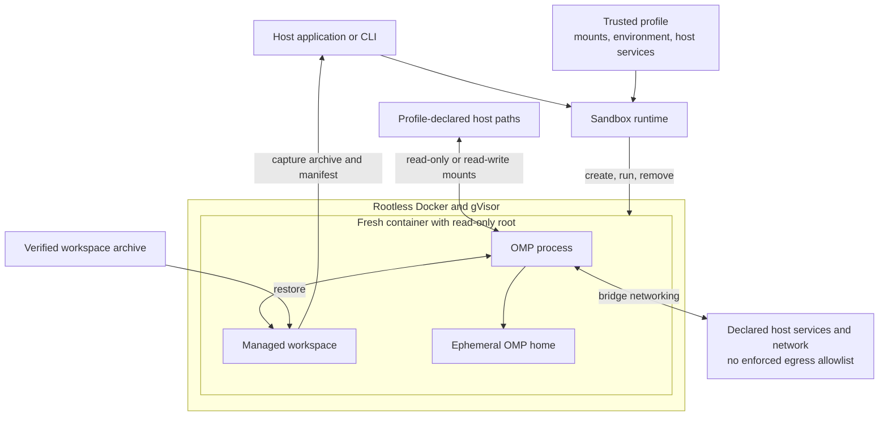

# Agents-in-a-Box

**A sandbox runtime for coding agents.** Runs [Oh My Pi (OMP)](https://github.com/can1357/oh-my-pi) in disposable containers using rootless Docker and gVisor, with a Python API and CLI.

---

## 🎯 Purpose

Coding agents typically run directly on the host machine with full user privileges

By default this means:
*   **Arbitrary code generation & execution**
*   **Nearly unrestricted filesystem access**
*   **Unrestricted network access**

While coding agents typically ask for permission or filter auto-approval for harmful commands, they can technically send any user-accessible (private) data to any publicly accessible domain, download & install arbitrary software in the userspace or execute arbitrary code.

- **Fresh containers:** each run starts clean and is removed afterward.
- **Explicit access:** profiles define host mounts, environment variables, and local services such as Ollama.
- **Workspace continuity:** verified archives and session manifests let work continue across runs without keeping a container alive.
- **Isolated Python:** run small scripts with a profile-defined interpreter and networking disabled.
 
---
 
## Security architecture: defense in depth


[Rootless Docker](https://docs.docker.com/engine/security/rootless/) runs without host root privileges. [gVisor](https://github.com/google/gvisor) adds a user-space kernel between the agent and the host. Containers have a read-only root filesystem, bounded writable temporary storage, all Linux capabilities dropped, and `no-new-privileges` enabled.

Profiles are trusted administrator policy. Prefer read-only mounts and grant only the secrets and services a task needs. Workspace archives are checked for unsafe paths, links, and file types. Host mounts inside the workspace are excluded from captures.



---
 
## Setup

Requires Python 3.10+, `uv`, a user systemd session, and `curl`, `tar`, `zstd`, and `sha512sum`. The setup script supports Debian, Ubuntu, and Arch Linux on `x86_64` and `aarch64`.

```bash
uv sync
./scripts/setup_agent_sandbox.sh
```

Setup installs or reuses rootless Docker, verifies and configures gVisor, builds the sandbox image, and configures access to declared host services. It uses `sudo` for host-level setup when needed.

Setup targets the current user's Docker socket at `/run/user/<uid>/docker.sock`. It leaves any rootful Docker service running and preserves unrelated settings in `~/.config/docker/daemon.json`, backing up the file before adding the `runsc` runtime.

Before running, copy the [bundled profile](src/agent_sandbox/profiles/gigachad.yaml) to an administrator-controlled directory as `example.yaml`. Set its `name` to `example` and adjust its absolute paths, mounts, and credentials for your machine. Mount the actual OMP executable, not a launcher such as a `mise` shim.

```bash
export AGENT_SANDBOX_PROFILE_PATH="/absolute/path/to/profiles"
uv run agent-sandbox doctor --profile example
```

Doctor checks Docker, gVisor, the image, mounts, OMP, interpreters, instructions, and declared services. It stops at the first failing stage.

<details>
<summary>Profile fields and local model access</summary>

Profiles are strict YAML files named `<profile>.yaml`. `AGENT_SANDBOX_PROFILE_PATH` accepts colon-separated directories, searched before bundled profiles.

| Field | Purpose |
| --- | --- |
| `name`, `image`, `workdir` | Profile identity, Docker image, and absolute working directory |
| `mounts` | Explicit host paths with container targets and `ro` or `rw` access |
| `omp_binary` | Path to the OMP executable inside the container |
| `python_interpreters` | Optional labels mapped to interpreter paths inside the container |
| `env_passthrough` | Optional host environment variables to forward |
| `host_services` | Optional environment-variable names mapped to host service ports |

For local inference, `host_services: {OLLAMA_HOST: 11434}` exposes Ollama as `http://10.200.200.1:11434`. The host service stays bound to `127.0.0.1`. Setup creates the loopback alias and per-port systemd proxies, defaulting to port `11434`.

To expose additional profile-declared ports, or configure an existing installation:

```bash
HOST_SERVICE_PORTS="11434 8080" ./scripts/setup_host_services.sh
```

</details>

---

## Usage

### CLI

Run a task and save its workspace and session manifest. Output directories must already exist.

```bash
mkdir -p artifacts
uv run agent-sandbox omp "Summarize the current workspace." \
  --profile example \
  --workspace-out artifacts/workspace.tar \
  --manifest-out artifacts/manifest.json
```

To continue the session, supply both saved files:

```bash
uv run agent-sandbox omp "Continue the workspace." \
  --profile example \
  --workspace-in artifacts/workspace.tar \
  --manifest-in artifacts/manifest.json \
  --workspace-out artifacts/next-workspace.tar \
  --manifest-out artifacts/next-manifest.json
```

Use `--model`, `--thinking`, `--append-system`, and `--lean` for per-run options. See `uv run agent-sandbox omp --help` for all flags. The command prints status, summary, and output events. Exit codes are `0` for completion, `1` for a non-completed result after saving outputs, and `2` for invalid inputs or sandbox errors.

### Python API

The library is the primary integration for applications that manage their own requests and storage.

```python
from agent_sandbox import OmpTask, Sandbox, SandboxInvocation

sandbox = Sandbox(namespace="tenant-a")
invocation = SandboxInvocation(
    slot_key="workspace-42",
    profile_name="example",
    run_id="request-001",
    task=OmpTask("Summarize the current workspace.", lean=True),
)

with sandbox.run(invocation) as result:
    print(result.status, result.summary)
    print(result.outputs)
    # Persist result.workspace and result.next_manifest here.
    # The local workspace archive is deleted when this block exits.
```

The caller owns storage. Save the archive at `result.workspace.path` with its `sha256` and the returned `next_manifest` before releasing the run.

<details>
<summary>Restoring workspaces and managing results</summary>

- **Restore files:** pass `workspace=WorkspaceArchive(path, sha256)` with a caller-downloaded archive. `WorkspaceArchive.from_file(path)` validates a local archive and records its digest.
- **Resume the session:** also pass the previous manifest as `active_manifest`. Its archive digest, profile, and image must match.
- **Read an artifact:** `result.read_workspace_file()` safely reads a bounded regular file from the captured workspace while the result is retained.
- **Release:** exiting the context manager, or calling `result.release()`, removes the temporary capture and cached result. `slot_key` and `run_id` provide in-process idempotency within one `Sandbox` instance.
- **Task options:** `OmpTask` accepts `prompt_images` (a tuple of `PromptImage`), `model`, `thinking`, `append_system`, and `lean`.
- **Errors:** sandbox failures derive from `AgentSandboxError`. Invalid invocation inputs raise `ValueError` or `TypeError`.

</details>


---


### Isolated Python

Choose an interpreter label declared in the profile, not a host executable path. Each script runs in a fresh, read-only, network-disabled container.

```python
from agent_sandbox import Sandbox

output = Sandbox().run_python_script(
    "venv",
    "print('hello from the sandbox')",
    timeout=30,
    profile_name="example",
)
print(output)
```

<details>
<summary>Runtime limits</summary>

| Boundary | Limit |
| --- | --- |
| OMP execution | 300 seconds |
| Prompt images | 32 MiB combined |
| Retained stdout and stderr | 4 MiB combined |
| Workspace archive | 512 MiB |
| `append_system` | 64 KiB |
| `/runtime` and `/tmp` tmpfs | 1 GiB and 64 MiB respectively |
| Container CPU, memory, and PIDs | No cgroup limits |

</details>
